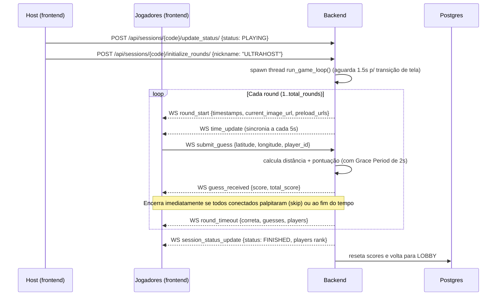

# Arquitetura

## Visão geral

Aplicação estilo [GeoGuessr](https://www.geoguessr.com): o jogador vê uma foto de um
lugar dentro da UFSCar São Carlos e precisa marcar no mapa onde acha que a foto foi
tirada. Quanto mais perto e mais rápido, mais pontos.

O sistema é dividido em três partes:

| Componente   | Tecnologia                                  | Porta (dev)  |
| ------------ | ------------------------------------------- | ------------ |
| Frontend     | React + TypeScript + Vite + Tailwind + Leaflet | `5173`     |
| Backend      | Python + Django + Django REST Framework + Django Channels (WebSocket) | `8000` |
| Banco de dados | PostgreSQL 15                              | `5432`     |

## Componentes

```
+---------------------+      REST (HTTP)      +---------------------+
|                     |   /api/..., /proxy/   |                     |
|   Frontend React    | <-------------------> |   Django REST API   |
|   (Vite :5173)      |                       |   (Daphne :8000)    |
|                     |                       |                     |
|                     |   WebSocket           |   Django Channels   |
|                     | <-------------------> |   (WS consumer)     |
+---------------------+   /ws/lobby/{code}/   +----------+----------+
                                                          |
                                                          | ORM
                                                   +------v------+
                                                   |  PostgreSQL  |
                                                   |    :5432     |
                                                   +-------------+
```

## Como as partes se comunicam

### REST (requisição/resposta)

Usado para tudo que é pontual:

- Obter cookie de proteção CSRF (`/api/set-csrf-token/`), adaptando dinamicamente `SameSite=Lax` (dev HTTP) e `SameSite=None; Secure` (produção HTTPS).
- Criar/listar/editar sessões, jogadores, localizações e rodadas (`/api/*`).
- Host iniciar o jogo (`update_status` + `initialize_rounds`).
- Buscar a imagem da rodada atual (`/api/rounds/current-image/` — mantido como endpoint auxiliar).
- Proxy de download das imagens do Google Drive (`/proxy/`).

### WebSocket (tempo real)

Usado para o que precisa ser broadcast ou sincronizado em tempo real para todos na sala:

- Entrar/reconectar na sala (`join`, `reconnect`) e reidratar o estado completo da partida (`sync_request` → `sync_state`).
- Manter a conexão ativa no Cloudflare Tunnel via heartbeat (`ping` → `pong` a cada 25s).
- Atualização da lista de jogadores e avatares.
- Loop do jogo: início de rodada (`round_start` com timestamps, imagem atual e fila de preload), confirmação periódica de tempo (`time_update` a cada 5s), fim de rodada (`round_timeout`) e resultado final.
- Envio de palpites (`submit_guess`), resposta com a pontuação (`guess_received`) e encerramento antecipado da rodada quando todos os jogadores conectados já palpitaram.

Todo cliente conectado em uma mesma sessão entra no grupo `session_{code}` do
channel layer. As mensagens do jogo são enviadas para esse grupo.

## Ciclo de vida da sessão

```
INACTIVE  ->  LOBBY  ->  PLAYING  ->  FINISHED  ->  (volta a LOBBY)
```

- `INACTIVE` — criada, ainda não usada.
- `LOBBY` — jogadores entram na sala (status padrão). Entrada só é aceita aqui.
- `PLAYING` — jogo em andamento.
- `FINISHED` — evento transitório enviado pelo WebSocket para exibir o ranking final; depois a sessão é persistida novamente como `LOBBY` para permitir uma nova partida na mesma sala.
- Ao final do loop do jogo, o backend reseta a sessão de volta para `LOBBY`
  (mantendo o código, para uma nova partida).

## Fluxo de uma partida



Detalhe importante: o host inicia o jogo por **REST** (`initialize_rounds`), que
dispara uma thread com o `run_game_loop` (em `Guessing_Game/gamelogic.py`). O cronômetro na tela dos jogadores é calculado localmente a partir dos timestamps absolutos (`round_started_at` e `server_now`), eliminando problemas de *jitter* na rede.

## Pontuação

Definida em `Guessing_Game/consumers.py` (`calculate_score`):

1. **Distância** (Haversine, em metros):
   `dist_score = 1000 * exp(-distancia / 600)` (máx. 1000)
2. **Bônus de tempo**:
   `time_bonus = tempo_restante / tempo_limite`
3. **Pontuação final**:
   `final = dist_score * (0.75 + 0.25 * time_bonus)` (limitado a 0–1000)

Ou seja: acerto perfeito vale até 1000 pontos, e cada segundo economizado no
palpite adiciona até 250 pontos ao "peso" da distância.

> **Grace Period (Tolerância de Latência):** palpites que chegam ao servidor até `2.0s` (`GRACE_PERIOD_SECONDS`) após o término de `time_limit` ainda são aceitos para não penalizar jogadores com latência de rede, tendo seu `tempo_restante` travado em `0` (pontuam apenas pela distância).

## Imagens das localizações (WebP + Look-Ahead Cache)

As fotos originais são referenciadas nos CSVs de seed (ex.: links do Google Drive) e otimizadas automaticamente pelo backend:

1. **Conversão para WebP no Backend:** durante o `seeder` (ou ao salvar uma `Location`), o método `Location.convert_to_webp()` baixa a imagem original, redimensiona para no máximo `1920x1080` (`Image.LANCZOS`), comprime em formato `.webp` (`quality=80`) na pasta `media/locations/location_{id}.webp` e salva o caminho `/media/locations/location_{id}.webp` no campo `image_url`.
2. **Entrega via WebSocket e Look-Ahead Preload:** o evento `round_start` (assim como o `sync_state`) envia diretamente a `current_image_url` da rodada `N` e o array `preload_urls` com as imagens das rodadas `N+1` e `N+2`. Assim que a imagem da rodada atual termina de carregar na tela (`onLoad`), o frontend faz o *preload* silencioso em segundo plano das duas próximas rodadas. Em produção, o Nginx serve `/media/` diretamente do disco com cabeçalhos `Cache-Control: public, max-age=604800, immutable`.

## Estrutura de pastas (backend)

```
backend/DACOMP_Guessr/
├── DACOMP_Guessr/            # projeto Django (settings, urls, asgi)
├── Guessing_Game/            # app principal
│   ├── models.py             # Session, Location (conversão WebP), Round, Player, Guess
│   ├── serializers.py        # DRF serializers
│   ├── views.py              # ViewSets + proxy + CSRF + start_game
│   ├── consumers.py          # WebSocket (entrada, sync_state, palpites, pontuação)
│   ├── gamelogic.py          # loop do jogo (paralelo, via thread, com skip de rodada)
│   ├── routing.py            # rotas do WebSocket
│   └── management/
│       ├── commands/
│       │   ├── seeder.py             # seed de locations/sessions/rounds
│       │   └── create_default_admin.py
│       └── seeders/                  # CSVs + scripts de seed
├── media/
│   └── locations/            # imagens convertidas e otimizadas em .webp
├── Dockerfile
├── entrypoint.sh             # migrações + admin + seed + runserver
└── requirements.txt
```